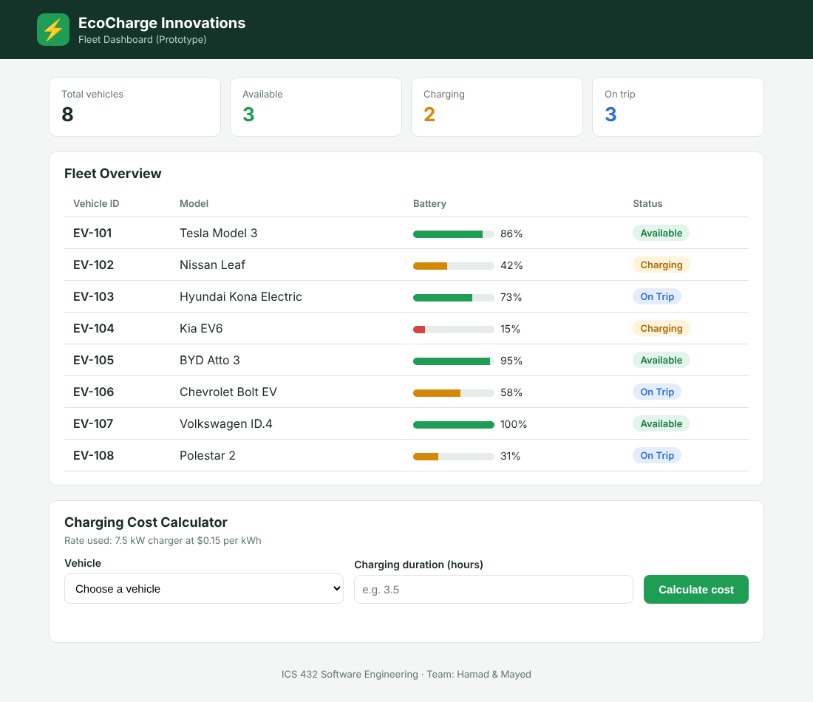
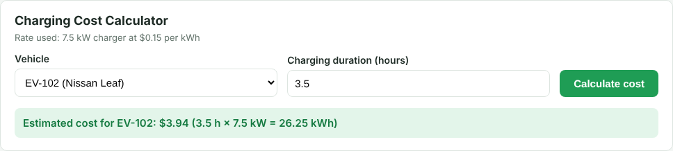
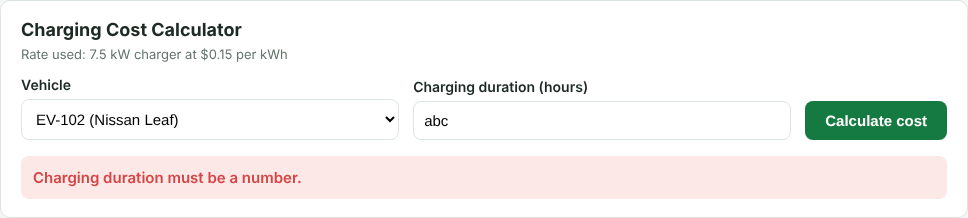
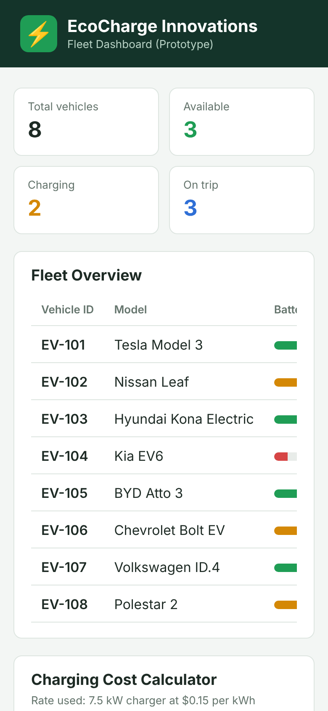
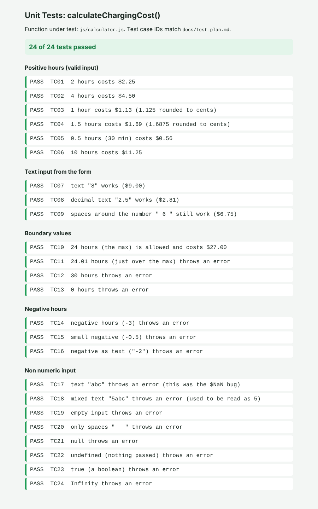

# EcoCharge Fleet Dashboard

ICS 432 Software Engineering group project
**Team:** Hamad (202319343), Mayed

A simple web prototype for EcoCharge Innovations that lets managers monitor a small fleet of electric vehicles. The goal was to prove the idea works and focus on clean code, teamwork (branches and pull requests), testing, and thinking about security and ethics, instead of building a full product.



## Contents

1. [Features](#features)
2. [How to run the app](#how-to-run-the-app)
3. [How to run the tests](#how-to-run-the-tests)
4. [How it works](#how-it-works)
5. [Project structure](#project-structure)
6. [Design decisions](#design-decisions)
7. [Code review note (bug we found and prevented)](#code-review-note-bug-we-found-and-prevented)
8. [Git workflow](#git-workflow)
9. [Agile documents](#agile-documents)
10. [Security and ethics](#security-and-ethics)
11. [Known limitations and future work](#known-limitations-and-future-work)
12. [Team contributions](#team-contributions)

## Features

### Feature A: Fleet Overview

* A table of **8 electric vehicles** showing Vehicle ID, Model, Battery % and Status
* **Battery bars** with colors so low battery cars stand out:
  * green for 70% and above
  * orange for 30% to 69%
  * red for under 30%
* **Status badges** in different colors for Available, Charging and On Trip
* **Summary cards** at the top that count the total vehicles and how many are in each status. These are counted from the data, so they stay right if the data changes.

### Feature B: Charging Cost Calculator

* Pick a vehicle from a dropdown (it's filled from the same fleet data as the table)
* Type the charging duration in hours (decimals like 2.5 are allowed)
* Click **Calculate cost** to see the cost and the energy used

**Formula:** `Cost = hours × 7.5 kW × $0.15 per kWh`

| Hours | Energy (kWh) | Cost |
|-------|--------------|------|
| 1 | 7.5 | $1.13 |
| 2 | 15 | $2.25 |
| 3.5 | 26.25 | $3.94 |
| 8 | 60 | $9.00 |
| 24 (max) | 180 | $27.00 |

If the input is wrong (empty, letters, zero, negative or more than 24 hours) it shows a red error message instead of a cost.

| Correct input | Wrong input |
|---------------|-------------|
|  |  |

### Extra: works on phones

On small screens the summary cards go into 2 columns and the table scrolls sideways.



## How to run the app

Built with plain HTML, CSS and JavaScript, so there's nothing to install.

1. Download or clone this repo:
   ```
   git clone https://github.com/Hamad9465/ev-fleet-dashboard.git
   ```
   (or click the green **Code** button on GitHub and pick **Download ZIP**, then unzip it)
2. Open the `ev-fleet-dashboard` folder.
3. Double click `index.html` to open it in any browser (Chrome, Edge, Firefox).

That's it, there is no server, database or packages to install.

## How to run the tests

1. Open the `tests` folder.
2. Double click `test.html`.
3. The page runs every test and shows PASS or FAIL for each one, grouped by type, with the total at the top. It should say **24 of 24 tests passed**.



The tests only cover the cost calculation function `calculateChargingCost()` in `js/calculator.js`, like the assignment asked. They check:

| Group | Test IDs | Examples |
|-------|----------|----------|
| Positive hours | TC01 to TC06 | 2 hours = $2.25, 1.5 hours = $1.69 |
| Text from the form | TC07 to TC09 | `"8"`, `"2.5"`, `" 6 "` |
| Boundaries | TC10 to TC13 | 0, 24, 24.01, 30 |
| Negative hours | TC14 to TC16 | -3, -0.5, `"-2"` |
| Non numeric input | TC17 to TC24 | `"abc"`, `"5abc"`, empty, `null`, `true`, `Infinity` |

For the error cases, the tests also check the **error message**, so we know it failed for the right reason. The full list of test cases with expected and actual results, plus our manual testing of the page, is in [`docs/test-plan.md`](docs/test-plan.md).

### Security tests

* **XSS attack test:** double click `tests/security-test.html`. It feeds our real `fleet.js` fake vehicles with attack code hidden inside and checks that none of it runs. It should say **5 of 5 security checks passed**.
* **Static analysis with ESLint** (needs Node.js): run `npm install eslint @eslint/js eslint-plugin-no-unsanitized globals`, then `npx eslint js tests/calculator.test.js`. Our code gives 0 problems. The setup is in `eslint.config.js`.

More detail on both is in the appendix of the [security memo](docs/security-memo.md).

## How it works

```
fleet-data.js  ──>  fleet.js           ──>  fleet table + summary cards
     │
     └────────>  calculator-ui.js  ──>  dropdown, form, result message
                       │
                       └──> calculator.js (calculateChargingCost)  <── tests/calculator.test.js
```

1. `fleet-data.js` holds the list of vehicles as a JavaScript array. Everything else reads from it, so the data is only in one place.
2. `fleet.js` loops through the list and builds a table row for each car, then counts the statuses for the summary cards.
3. `calculator-ui.js` fills the dropdown with the cars, listens for the form submit, and shows the result or the error.
4. `calculator.js` has only the math and the input checks. It doesn't touch the page at all, which is why it can be tested on its own.

## Project structure

```
ev-fleet-dashboard/
├── index.html              main dashboard page
├── css/style.css           styling
├── eslint.config.js        ESLint setup for static analysis
├── js/
│   ├── fleet-data.js       static list of vehicles
│   ├── fleet.js            Feature A: builds the fleet table and summary cards
│   ├── calculator.js       Feature B: cost calculation function
│   └── calculator-ui.js    Feature B: connects the form to the function
├── tests/
│   ├── test.html           open this to run the tests
│   ├── calculator.test.js  the unit tests (24 test cases)
│   └── security-test.html  XSS attack test (open in a browser)
└── docs/
    ├── product-backlog.md       user stories, story points, acceptance criteria
    ├── sprint-plan.md           tasks, who did what, estimates, Definition of Done
    ├── sprint-retrospective.md  what went well, what we'd change, action items
    ├── test-plan.md             every test case with expected and actual results
    ├── security-memo.md         two security risks + appendix
    ├── ethics-memo.md           privacy memo using the ACM Code + appendix
    └── screenshots/             images used in this README
```

## Design decisions

| Decision | Why |
|----------|-----|
| Plain HTML, CSS and JavaScript (no framework) | The assignment recommended it, and it means anyone can run it by double clicking a file. It kept our focus on the logic and teamwork. |
| Data in a JavaScript array instead of a JSON file | Browsers block loading a JSON file with `fetch` when you open the page straight from a file (no server), so the array was the simplest way to keep it working with no setup. |
| Cost logic in its own file (`calculator.js`) | Keeping the math separate from the page code means we can unit test it without a browser page, and the UI file stays simple. |
| Fixed values saved as constants (`CHARGER_POWER_KW`, `PRICE_PER_KWH`) | If the price changes later, it's changed in one place instead of hunting for numbers in the code. |
| Max of 24 hours | Charging a car for more than a full day doesn't make sense, so anything above that is probably a typo. |
| Using `textContent` instead of `innerHTML` | So any data shown on the page is treated as plain text and can't run as code (see the security memo). |
| Hours input is a text box, not a number box | A number box lets some browsers accept things like `e` and gives an empty value for bad input, so our own check gives clearer error messages. |

## Code review note (bug we found and prevented)

In the first version of the calculator, the function used `parseFloat(hours)` to read the input. When we tested it we found two problems:

* Typing letters like `abc` showed **"$NaN"** as the cost
* Typing something like `5abc` was quietly read as 5 hours, so the user got a cost even though their input was wrong

```js
// first version (buggy)
const value = parseFloat(hours);   // parseFloat("abc") = NaN, parseFloat("5abc") = 5
```

We fixed it by only accepting real numbers (or text that is fully a number) and throwing a clear error for anything else, like "Charging duration must be a number." We also block 0, negative hours and anything over 24 hours.

```js
// fixed version
if (typeof value === "string") {
  value = value.trim() === "" ? NaN : Number(value);   // Number("5abc") = NaN
}
if (typeof value !== "number" || !Number.isFinite(value)) {
  throw new Error("Charging duration must be a number.");
}
```

You can see this in the commit history: the commit `feat: add charging cost calculator form and logic` has the buggy version and the next one, `fix: reject non numeric and empty charging duration`, fixes it. Test cases TC17 and TC18 check this exact bug, so it can't come back without a test failing. The same note is also written as a comment above the function in `js/calculator.js`.

## Git workflow

We used GitHub for this project (our instructor said GitHub or GitLab is fine). On GitHub, merge requests are called **pull requests**, but they work the same way.

**Branches and pull requests:**

| Branch | What it added | Made by | Reviewed and merged by |
|--------|---------------|---------|------------------------|
| `feature/fleet-overview` | Feature A: page layout, fleet data, fleet table | Hamad | Mayed |
| `feature/cost-calculator` | Feature B: calculator, input fix, unit tests | Mayed | Hamad |
| `docs/memos-and-readme` | Memos, README, fixed the folder structure | Hamad | Mayed |
| `test/more-test-cases` | More unit tests, the test plan, XSS security test page and ESLint setup | Mayed | Hamad |
| `docs/more-details` | Security analysis, more detail in the docs and README, screenshots | Hamad | Mayed |

Our rules were:
* Nobody commits straight to `main`, everything goes through a branch and a pull request
* The other person has to review and approve before merging
* One branch per feature or task

**Commit message format** (Conventional Commits):

| Prefix | Used for | Example from our repo |
|--------|----------|-----------------------|
| `feat:` | a new feature | `feat: show fleet table with battery bars and status badges` |
| `fix:` | fixing a bug | `fix: reject non numeric and empty charging duration` |
| `test:` | adding or changing tests | `test: add unit tests for charging cost function` |
| `docs:` | documents and README | `docs: add security memo, ethics memo and retrospective` |
| `refactor:` | moving or cleaning code without changing what it does | `refactor: move project files out of step folders to root` |

## Agile documents

All in the `docs` folder:

* [Product backlog](docs/product-backlog.md): 11 user stories with MoSCoW priority, story points and acceptance criteria
* [Sprint plan](docs/sprint-plan.md): roles, timeline, every task with who did it and an hour estimate, and our Definition of Done
* [Sprint retrospective](docs/sprint-retrospective.md): what went well, what we'd change, and action items for next time

## Security and ethics

* [Security memo](docs/security-memo.md): Cross-Site Scripting (XSS) and missing login, with impact and fixes. The appendix has a risk rating, an attack example, other attack vectors (SQL injection, CSRF, clickjacking and more), and the results of our static analysis (code review and ESLint) and dynamic analysis (XSS attack page and input fuzzing).
* [Ethics memo](docs/ethics-memo.md): privacy of vehicle location data using the ACM Code of Ethics. The appendix has the ACM principles we used, the stakeholders and extra mitigations.

## Known limitations and future work

**Limitations (on purpose, since it's a prototype):**
* Vehicle data is fixed in the code and doesn't change
* No login, anyone with the file can open it
* The price and charger power are fixed (7.5 kW and $0.15 per kWh)
* No server or database

**What we'd add next:**
1. A login for managers (security memo, risk 2)
2. A small backend (like Node.js/Express or Flask) with a database so data can be added and edited
3. Live battery and status updates
4. Filter and sort for the fleet table
5. Different charger types and prices in the calculator
6. A live map, but only after the privacy steps in the ethics memo are in place

## Team contributions

| Hamad | Mayed |
|-------|-------|
| Set up the repo and planning docs | Charging cost function and calculator form |
| Page layout and styling | Input validation fix (the $NaN bug) |
| Fleet data, fleet table and summary cards | Unit tests (24 test cases) |
| Security memo and security analysis | Test plan |
| Ethics memo | XSS security test page and ESLint setup |
| README and screenshots | Reviewed and merged Hamad's pull requests |
| Reviewed and merged Mayed's pull requests | |
| Retrospective and demo video (together) | Retrospective and demo video (together) |
